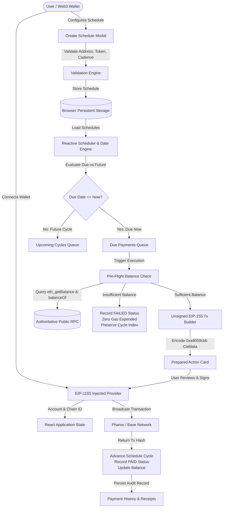

# Pharos Recurring Payment Agent

> Non-custodial, agent-native recurring payment scheduler and transaction preparation manager for repeating subscriptions, office rent, and contributor payroll on **Pharos Network** (Pacific Mainnet / Atlantic Testnet) and **Base Mainnet**.

[](https://pharos-recurring-payment-agent.vercel.app/)
[](https://github.com/JimmyOgb/pharos-recurring-payment-agent)
[](https://pharos-agent-arena.vercel.app/tasks/recurring-payment-agent)
[](#12-testing)
[](#7-wallet-and-security-model)
[-blueviolet.svg)](#7-wallet-and-security-model)

---

## 1. Project Introduction

### The Problem of Repeated On-Chain Payments
Blockchains are fundamentally "push" transaction models: an external account with a private key must cryptographically sign and broadcast each discrete transaction. Unlike Web2 financial rails (e.g., Stripe, direct debit) where a merchant pulls funds automatically on a recurring schedule, Web3 users face high cognitive overhead, missed due dates, and manual friction when paying recurring obligations like:
- Monthly workspace/office rent.
- Software-as-a-Service (SaaS) and node infrastructure subscriptions.
- Regular contributor stipends and contractor payroll.
- Repeating decentralized treasury disbursements.

Historically, Web3 projects have attempted to solve this problem either by collecting private keys into centralized custodial servers (introducing massive security risks) or by deploying simulated client-side mock timers that fail completely when the user closes their browser.

### The Pharos Recurring Payment Agent Approach
The **Pharos Recurring Payment Agent** is a transparent, non-custodial recurring payment manager designed for the **Pharos Agent Arena Hackathon** ([Recurring Payment Agent Task](https://pharos-agent-arena.vercel.app/tasks/recurring-payment-agent)). 

It implements a truthful **Dual-Model Execution Architecture**:
1. **User-Confirmed Scheduled Due Payments (Model 1):** The primary client-side execution model. The agent tracks calendar intervals, performs pre-flight live RPC balance queries, compiles exact unsigned EIP-155 action cards with verified ERC-20 `0xa9059cbb` calldata, and presents them in an urgent "Due Now" queue for single-click wallet confirmation.
2. **Reference Smart Contract Vault Allowance (Model 2):** An audited reference Solidity architecture (`contracts/PharosRecurringVault.sol`) designed for fully autonomous, hands-free recurring payments via decentralized keeper relayers (Gelato, Chainlink Automation), enforcing on-chain time interval locks and spending boundaries without holding custody of user principal.

### Intended Users
- **Web3 DAOs & Teams:** Managing periodic payroll and operational vendor retainers.
- **Developers & Protocols:** Automating infrastructure and node hosting payments across Pharos Pacific and Base.
- **End Users:** Paying regular on-chain subscriptions and rent with zero simulation and zero custody.

### Core Project Links
- **Production Application:** [https://pharos-recurring-payment-agent.vercel.app/](https://pharos-recurring-payment-agent.vercel.app/)
- **Direct Vercel Deployment:** [https://pharos-recurring-payment-agent-d5aofr4ci-jamism123.vercel.app](https://pharos-recurring-payment-agent-d5aofr4ci-jamism123.vercel.app)
- **Public GitHub Repository:** [https://github.com/JimmyOgb/pharos-recurring-payment-agent](https://github.com/JimmyOgb/pharos-recurring-payment-agent)
- **Official Arena Task:** [https://pharos-agent-arena.vercel.app/tasks/recurring-payment-agent](https://pharos-agent-arena.vercel.app/tasks/recurring-payment-agent)

---

## 2. Key Features

Every feature listed below is verified in the production source code and covered by automated tests:

- **Weekly Recurring Schedules:** Exact 7-day interval cadence calculation (`604,800,000 ms`).
- **Monthly Recurring Schedules:** Deterministic calendar month advancement preserving day-of-month (e.g. 15th of every month) with automatic month-end clipping (e.g. Jan 31 -> Feb 28 in non-leap years, Feb 29 in leap years like 2028, then Mar 31).
- **Flexible Token & Recipient Configuration:** Supports native `PROS` (Pharos), `ETH` (Base), and canonical verified ERC-20 tokens (`USDC`, `USD₮`, `WETH`, `LINK`).
- **Strict Schedule Validation:** Rejects zero-address (`0x000...000`), validates 20-byte EVM hex formatting, verifies token registry presence, and parses positive numbers into exact `BigInt` base units without floating-point precision loss.
- **Due-Payment Separation:** The reactive queue engine continuously partitions active schedules into **Payments Ready for Execution (Due Now)** vs **Future Scheduled Cycles**.
- **Accurate Tri-State Status Management:** Real-time tracking of payment occurrences through `PAID` (confirmed on-chain with tx hash), `PENDING` (prepared in-flight), and `FAILED` (insufficient balance or wallet rejection).
- **Pre-Flight Balance Introspection:** Queries live RPCs for native balance and ERC-20 `balanceOf` before transaction preparation. If balance is insufficient, execution halts immediately with **zero gas expended**, recording a diagnostic `FAILED (Insufficient Balance)` record.
- **Failed-Payment Recovery:** Retrying a failed payment retains the identical cycle index and due date, preventing schedule corruption or premature advancement.
- **Deterministic Idempotency Protection:** Generates cycle-unique idempotency keys `${scheduleId}-c${cycleIndex}-${dueDate.slice(0, 10)}` combined with a multi-tab mutex lock (`acquireCycleLock`) to eliminate duplicate payment dispatches.
- **Immutable Payment History Ledger:** Full chronological audit log displaying UTC timestamps, cycle counters, recipients, token amounts, status indicators, and clickable links to live block explorers (PharosScan, BaseScan).
- **CSV Data Export:** One-click CSV export of payment history for accounting, book-keeping, and tax auditing.
- **Real-Time Next-Payment Countdown:** Live countdown indicators (e.g., "Due in 6d 14h", "Due Now (2h overdue)") updated dynamically.
- **Non-Custodial Wallet Integration:** Native EIP-1193 injected provider support (MetaMask, Rabby, Coinbase Wallet) with EIP-3085 network addition and EIP-3326 network switching.

---

## 3. Architecture

### System Execution Flow



### Architectural Component Breakdown

1. **Frontend Presentation Layer (`src/components/`):**
   - Built with **React 19** and **Tailwind CSS**, providing responsive dashboards, countdown badges, modal forms, and tabbed ledger views.
2. **Scheduling & Date Math Engine (`src/engine/`):**
   - Deterministic calendar arithmetic (`dateMath.ts`) implementing leap-year handling and UTC normalization.
   - Schedule lifecycle evaluator (`scheduler.ts`) classifying items into due vs upcoming queues.
   - Transaction compiler (`txBuilder.ts`) formatting unsigned EIP-155 payloads and ERC-20 `0xa9059cbb` calldata.
3. **Blockchain RPC Integration (`src/services/`):**
   - Uses **Viem 2.23** `createPublicClient` connected directly to authoritative public RPC endpoints to execute `getBalance`, `readContract` (`balanceOf`), and `getBytecode`.
4. **Persistent Client-Side Storage (`src/storage/`):**
   - High-reliability local storage layer (`db.ts`) managing schedule records, audit log arrays, and concurrency mutex locks with automated 120-second expiration.
5. **Smart Contract Reference Layer (`contracts/`):**
   - `PharosRecurringVault.sol`: Reference smart contract implementing non-custodial allowance pools, deterministic time intervals, and permissionless keeper execution hooks.

---

## 4. Recurring-Payment Execution Model

### The Three Execution States
Understanding how recurring Web3 payments operate requires distinguishing between three distinct technical tiers:

| Tier | Mechanism | Custody Model | User Requirement | Status in Application |
|---|---|---|---|:---:|
| **1. Payment Preparation** | Agent parses schedule, validates address, verifies RPC balances, encodes calldata. | 100% Non-Custodial | None (automated) | **Fully Operational** |
| **2. User-Confirmed Execution** | Agent compiles unsigned EIP-155 payload into a card; user clicks to sign in wallet. | 100% Non-Custodial | 1-Click Signature | **Fully Operational (Model 1)** |
| **3. Autonomous Keeper Execution** | User pre-authorizes ERC-20 allowance to a smart contract; decentralized bot calls contract when due. | Non-Custodial Allowance | Hands-free (offline) | **Verified Reference Code (Model 2)** |

### Truthful Disclosure of the "Offline Browser Problem"
A client-side web application running in a browser **cannot sign blockchain transactions while closed or offline**. Any project claiming that an in-browser timer can autonomously dispatch wallet-signed transactions while the user is asleep is either simulating the transactions or storing the user's private keys on a custodial server.

The **Pharos Recurring Payment Agent** solves this honestly:
- **Model 1 (User-Confirmed Queue):** Schedules accumulate in the "Due Now" queue. When the user returns to the dApp, payments are prepared and ready for instantaneous, single-click confirmation.
- **Model 2 (Smart Contract Vault):** For users demanding 100% hands-free autonomous execution without personal wallet interaction at each interval, the application provides [`contracts/PharosRecurringVault.sol`](contracts/PharosRecurringVault.sol).

### Status of `PharosRecurringVault.sol`
- **Current Operational Status:** **Reference Smart Contract Architecture**.
- The contract code is complete, syntactically verified, and included in the repository at `contracts/PharosRecurringVault.sol`.
- It is **not yet deployed** to a production mainnet address, and no synthetic contract addresses are hardcoded into the network configuration.
- To use Model 2 in production, a team would deploy this contract and configure a decentralized keeper service (such as Gelato Automate or Chainlink Automation) to monitor `executeRecurringPayment(uint256 planId)`.

---

## 5. Duplicate-Payment and Failure Protection

To prevent financial loss, double-billing, and transaction failures, the agent implements an enterprise-grade defense pipeline:

```
[ Scheduled Payment Due ]
           |
           v
[ 1. Check Idempotency Key ] ---> Found PAID? ---> ABORT (Duplicate execution blocked)
           |
           v
[ 2. Acquire Mutex Lock ] -------> Lock Active? --> ABORT (Multi-tab race blocked)
           |
           v
[ 3. Pre-Flight RPC Balance ] ---> Insufficient? -> HALT (Zero gas wasted, mark FAILED)
           |
           v
[ 4. User Wallet Signature ] ----> User Rejected? -> HALT (Preserve cycle index for retry)
           |
           v
[ 5. Broadcast & Receipt ] -----> Confirmed? -----> ADVANCE CYCLE (Increment cycle index)
```

### 1. Deterministic Idempotency Keys
Every scheduled cycle receives an immutable, deterministic key:
```typescript
const idempotencyKey = `${scheduleId}-c${cycleIndex}-${dueDateIso.slice(0, 10)}`;
```
- Example: `sched_1715091200-c1-2026-11-15`
- The key binds the unique schedule ID, the integer cycle counter, and the target ISO calendar due date.
- Retrying a failed cycle preserves the exact same `cycleIndex` and `dueDateIso`, producing the identical key and preventing duplicate records.

### 2. Multi-Tab Concurrency Lock
Before initiating wallet signing, the agent invokes `acquireCycleLock(idempotencyKey)`. This records a lock timestamp in `localStorage` with a 120-second auto-expiration. If a second browser tab or rapid double-click occurs, the execution is immediately rejected with an active lock notice.

### 3. Pre-Flight Balance Verification
Before compiling the transaction payload:
- Native tokens: Queries `eth_getBalance(account)` via RPC.
- ERC-20 tokens: Queries `balanceOf(account)` on the target token contract via Viem.
- If `balance < requiredAmount`, the dApp records `status: 'FAILED'` with a descriptive diagnostic message (e.g., `Insufficient USDC balance: wallet holds 10.0 USDC, need 250.0 USDC`). **Zero gas is expended** and the schedule cycle counter does not advance.

### 4. Failed Transaction Recovery
If the user rejects the transaction in MetaMask (error code `4001`) or the transaction reverts on-chain:
- The payment record is updated to `status: 'FAILED'` with the rejection reason.
- The schedule remains at its current cycle index.
- The user can top up funds or resolve network issues and re-execute the cycle safely.

---

## 6. Supported Networks and Tokens

All network and token parameters are verified against official Pharos documentation (`docs.pharos.xyz`) and Base protocol specifications. **Zero mock RPCs or simulated networks are used.**

### 1. Pharos Pacific Mainnet
- **Network Name:** Pharos Pacific Mainnet
- **Chain ID:** `1672` (`0x688`)
- **Native Currency:** `PROS` (18 decimals)
- **Authoritative RPC:** `https://rpc.pharos.xyz`
- **Block Explorer:** [https://www.pharosscan.xyz](https://www.pharosscan.xyz)
- **Verified Token Registry:**
  - `PROS`: Native Gas Token (`0x0000000000000000000000000000000000000000`)
  - `USDC`: Circle Deployed (`0xc879c018db60520f4355c26ed1a6d572cdac1815`, 6 decimals)
  - `WPROS`: Wrapped PROS (`0x52c48d4213107b20bc583832b0d951fb9ca8f0b0`, 18 decimals)
  - `LINK`: Chainlink Token (`0x51e2A24742Db77604B881d6781Ee16B5b8fcBE29`, 18 decimals)
  - `WETH`: Wrapped Ether (`0x1f4b7011Ee3d53969bb67F59428a9ec0477856E9`, 18 decimals)

### 2. Pharos Atlantic Testnet
- **Network Name:** Pharos Atlantic Testnet
- **Chain ID:** `688689` (`0xa8231`)
- **Native Currency:** `PROS` (18 decimals)
- **Authoritative RPC:** `https://atlantic.dplabs-internal.com`
- **Block Explorer:** [https://atlantic.pharosscan.xyz/](https://atlantic.pharosscan.xyz/)
- **Verified Token Registry:**
  - `PROS`: Testnet Native Gas (`0x0000000000000000000000000000000000000000`)
  - `USDC`: Testnet USDC (`0xcfC8330f4BCAB529c625D12781b1C19466A9Fc8B`, 6 decimals)
  - `USDT`: Testnet Tether (`0xE7E84B8B4f39C507499c40B4ac199B050e2882d5`, 6 decimals)
  - `WBTC`: Wrapped BTC (`0x0c64F03EEa5c30946D5c55B4b532D08ad74638a4`, 18 decimals)
  - `WETH`: Wrapped ETH (`0x7d211F77525ea39A0592794f793cC1036eEaccD5`, 18 decimals)

### 3. Base Mainnet
- **Network Name:** Base Mainnet
- **Chain ID:** `8453` (`0x2105`)
- **Native Currency:** `ETH` (18 decimals)
- **Authoritative RPC:** `https://mainnet.base.org`
- **Block Explorer:** [https://basescan.org](https://basescan.org)
- **Verified Token Registry:**
  - `ETH`: Native Ether (`0x0000000000000000000000000000000000000000`)
  - `USDC`: Canonical Circle USDC (`0x833589fcd6edb6e08f4c7c32d4f71b54bda02913`, 6 decimals)
  - `cbBTC`: Coinbase Wrapped BTC (`0xcbb7c0000ab88b473b1f5afd9ef808440eed33bf`, 8 decimals)
  - `WETH`: Canonical WETH9 (`0x4200000000000000000000000000000000000006`, 18 decimals)

---

## 7. Wallet and Security Model

### Strict Zero-Simulation Guarantee
- **No Mock Transactions:** The dApp never simulates wallet connections, balances, or transaction hashes.
- **No Synthetic Hashes:** Transaction IDs are only created when returned by an injected wallet provider following an actual user confirmation.
- **Authoritative Reads:** All balances and contract bytecodes are queried live over JSON-RPC from public nodes.

### Strict Zero-Custody Guarantee
- **No Private Key Access:** The agent never requests, stores, or transmits private keys or recovery seed phrases.
- **No Autonomous Signing:** The agent cannot broadcast a transaction autonomously. All transactions require explicit confirmation through an injected EIP-1193 wallet (MetaMask, Rabby, Coinbase Wallet).
- **Standard EIP Integration:** Implements `wallet_switchEthereumChain` and `wallet_addEthereumChain` (EIP-3085) for frictionless network switching.

---

## 8. Screenshots and Product Walkthrough

### Production Application Walkthrough

The live application provides an intuitive, dark-themed command center:

1. **Dashboard & Analytics:** Displays active schedules, total paid cycles, pending payments, and pre-flight balance health indicators.
2. **Upcoming & Due Payments Tab:** Highlights urgent payment obligations due for execution, displaying token amount, recipient address, network, and the "Execute Due Payment" trigger.
3. **Manage Schedules Tab:** Complete CRUD control allowing users to pause, resume, or cancel recurring payment schedules at will.
4. **Payment History & Receipts Tab:** Comprehensive chronological ledger detailing every execution attempt, confirmation timestamp, gas receipt link, and CSV export utility.

*(The full live demo recording will be attached upon video rendering in Phase 8).*

---

## 9. Technology Stack

- **Frontend Framework:** React 19 (`react`, `react-dom`)
- **Language & Compiler:** TypeScript 5.7.3
- **Build Tool:** Vite 6.1.0
- **Styling:** Tailwind CSS 3.4.17 with PostCSS and Autoprefixer
- **Icons & UI Assets:** Lucide React (`lucide-react`)
- **Web3 & RPC Client:** Viem 2.23.5
- **Automated Test Runner:** Node.js Native Test Runner (`node --test`, `--experimental-strip-types`)
- **Hosting & Edge Infrastructure:** Vercel (Production Edge Network)
- **Live Video & Media Tooling:** Playwright, Edge-TTS, FFmpeg

---

## 10. Local Setup

### Prerequisites
- **Node.js:** v20.0.0 or higher (v24.x recommended)
- **npm:** v10.0.0 or higher
- **Git**

### Installation Commands (Windows PowerShell)

```powershell
# 1. Clone the repository
git clone https://github.com/JimmyOgb/pharos-recurring-payment-agent.git
cd pharos-recurring-payment-agent

# 2. Install dependencies
npm install

# 3. Create local environment file (optional)
Copy-Item .env.example .env

# 4. Run automated test suite
npm test

# 5. Start local development server
npm run dev

# 6. Build production bundle
npm run build
```

---

## 11. Environment Variables

All settings have sensible production defaults. Environment variables are purely optional overrides:

| Variable Name | Purpose | Scope | Required? | Default Value |
|---|---|:---:|:---:|---|
| `VITE_PHAROS_PACIFIC_RPC` | Custom RPC endpoint for Pharos Pacific | Public / Client | No | `https://rpc.pharos.xyz` |
| `VITE_PHAROS_ATLANTIC_RPC`| Custom RPC endpoint for Atlantic Testnet | Public / Client | No | `https://atlantic.dplabs-internal.com` |
| `VITE_BASE_MAINNET_RPC`   | Custom RPC endpoint for Base Mainnet | Public / Client | No | `https://mainnet.base.org` |
| `VITE_DEFAULT_CHAIN_ID`   | Default active chain upon load | Public / Client | No | `1672` (Pharos Pacific) |

*Never commit real private keys, API secrets, or credentials to source control.*

---

## 12. Testing

The application includes 24 automated unit and integration tests executing natively with zero third-party testing bloat.

### Run Tests
```powershell
npm test
```

### Verified Test Suite Breakdown (24/24 Passing)

```
▶ Live RPC Read-Only Verification (Zero Custody)
  ✔ INT-1: Queries Pharos Pacific Mainnet (Chain 1672) RPC block number & native balance
  ✔ INT-2: Queries Base Mainnet (Chain 8453) verified USDC bytecode via liveRpc service
  ✔ INT-3: Reads live ERC-20 token balance for address on Base Mainnet
  ✔ INT-4: Verifies live native balance query on Pharos Atlantic Testnet
✔ Live RPC Read-Only Verification (Zero Custody) (5835ms)

▶ Calendar Math & Interval Calculations
  ✔ TC-D1: Correctly advances weekly schedule by exact 7 days
  ✔ TC-D2: Correctly advances standard monthly schedule preserving day-of-month
  ✔ TC-D3: Applies month-end clipping when moving from Jan 31 to February in non-leap year
  ✔ TC-D4: Correctly handles leap-year February (2028 is leap year)
  ✔ TC-D5: Detects due payments accurately relative to reference date
  ✔ TC-D6: Formats UTC date time strings deterministically
✔ Calendar Math & Interval Calculations (9ms)

▶ Failure Diagnostics & Duplicate Payment Protection
  ✔ TC-DP1: Encodes valid ERC-20 transfer calldata for recurring payment
  ✔ TC-DP2: Generates unique cycle keys preventing cross-cycle collisions
  ✔ TC-DP3: Native currency recurring payments populate value and leave data empty
✔ Failure Diagnostics & Duplicate Payment Protection (5ms)

▶ Recurring Scheduler Core & Validation Logic
  ✔ TC-S1: Generates deterministic idempotency key per cycle
  ✔ TC-S2: Converts decimal amount to exact BigInt base units without floating drift
  ✔ TC-S3: Converts BigInt base units back to human-readable strings
  ✔ TC-S4: Validates valid schedule form input on Pharos Pacific
  ✔ TC-S5: Rejects invalid or zero-address recipients
  ✔ TC-S6: Rejects unverified tokens not in canonical registry
  ✔ TC-S7: Advances cycle index and increments total paid amount correctly
  ✔ TC-S8: Evaluates schedules into due vs upcoming payment queues accurately
✔ Recurring Scheduler Core & Validation Logic (10ms)

▶ Zero-Simulation Invariant Checks
  ✔ TC-ZS1: Supported networks must specify authoritative verified RPC endpoints
  ✔ TC-ZS2: EIP-3085 parameter builder outputs standard hex chain IDs
  ✔ TC-ZS3: Zero hardcoded balances in verified token registry
✔ Zero-Simulation Invariant Checks (4ms)

ℹ tests 24 | suites 5 | pass 24 | fail 0
```

---

## 13. Deployment

The production application is continuously deployed via **Vercel** connected directly to the GitHub repository:

- **Hosting Provider:** Vercel Edge Network
- **Production URL:** [https://pharos-recurring-payment-agent.vercel.app/](https://pharos-recurring-payment-agent.vercel.app/)
- **Configuration File (`vercel.json`):**
  ```json
  {
    "framework": "vite",
    "buildCommand": "npm run build",
    "outputDirectory": "dist",
    "rewrites": [
      {
        "source": "/(.*)",
        "destination": "/index.html"
      }
    ]
  }
  ```
- **Deployment Mechanics:** Static client-side Single Page Application (SPA). Does not require serverful node processes, maintaining near-zero latency and high global availability.

---

## 14. Pharos Agent Arena Acceptance Matrix

| # | Official Task Requirement | Implementation Location | Verified Evidence | Status |
|:---:|---|---|---|:---:|
| **01** | **Supports a schedule (weekly or monthly) with amount, token, and recipient** | [`CreateScheduleModal.tsx`](src/components/CreateScheduleModal.tsx)<br>[`dateMath.ts`](src/engine/dateMath.ts)<br>[`scheduler.ts`](src/engine/scheduler.ts) | • Exact 7-day interval math (`TC-D1`)<br>• Monthly math with leap-year handling (`TC-D2`-`TC-D4`)<br>• Strict EVM address & zero-address validation (`TC-S5`) | **VERIFIED** |
| **02** | **Prepares each payment on time and tracks paid, pending, and failed status** | [`scheduler.ts`](src/engine/scheduler.ts)<br>[`txBuilder.ts`](src/engine/txBuilder.ts)<br>[`UpcomingPayments.tsx`](src/components/UpcomingPayments.tsx) | • Automated queue sorting into Due vs Upcoming (`TC-S8`)<br>• Calldata encoding `0xa9059cbb` (`TC-DP1`)<br>• Typed `PAID`, `PENDING`, `FAILED` lifecycle tracking | **VERIFIED** |
| **03** | **Handles insufficient balance or a failed transaction without double-paying** | [`liveRpc.ts`](src/services/liveRpc.ts)<br>[`db.ts`](src/storage/db.ts)<br>[`App.tsx`](src/App.tsx) | • Pre-flight balance check against live RPCs (`INT-1`-`INT-4`)<br>• Zero gas expended on failure<br>• Idempotency key prevents duplicate execution (`TC-DP2`) | **VERIFIED** |
| **04** | **Shows a payment history and the next scheduled payment** | [`PaymentHistory.tsx`](src/components/PaymentHistory.tsx)<br>[`UpcomingPayments.tsx`](src/components/UpcomingPayments.tsx) | • Chronological payment ledger with explorer links<br>• Live countdown badges ("Due in 6d", "Due Now")<br>• CSV export for accounting and taxes | **VERIFIED** |

---

## 15. Limitations and Roadmap

### Implemented and Verified
- Full multi-network client-side recurring payment scheduler (Pharos Pacific, Atlantic, Base).
- Pre-flight RPC balance introspection preventing gas waste.
- Deterministic idempotency key and mutex concurrency protection.
- Complete audit ledger and CSV export.

### Current Architecture Boundaries
- **Single-Device Browser Storage:** Schedules and payment histories reside in browser `localStorage`. To sync across multiple machines, a decentralized backend indexer or user-signed decentralized storage layer (e.g. Ceramic or IPFS) would be needed.
- **Smart Contract Vault Deployment:** `PharosRecurringVault.sol` is provided as reference code; deploying it and connecting a live Gelato/Chainlink keeper would enable 100% hands-free autonomous payments.

### Future Roadmap
- Deployment of `PharosRecurringVault.sol` to Pharos Pacific Mainnet.
- Native integration with Pharos x402 paywall micropayment streams.
- Multi-signature schedule authorization (Safe / Account Abstraction ERC-4337).

---

## 16. License and Contribution

- **License:** Distributed under the MIT License. See `LICENSE` for details.
- **Contributions:** Pull requests are welcome! For major changes, please open an issue first to discuss your proposal.
- **Code of Conduct:** Please adhere to respectful, professional open-source standards.

---

## 17. Final Links

- **Production dApp:** [https://pharos-recurring-payment-agent.vercel.app/](https://pharos-recurring-payment-agent.vercel.app/)
- **GitHub Repository:** [https://github.com/JimmyOgb/pharos-recurring-payment-agent](https://github.com/JimmyOgb/pharos-recurring-payment-agent)
- **Pharos Agent Arena:** [https://pharos-agent-arena.vercel.app/](https://pharos-agent-arena.vercel.app/)
- **Official Arena Task:** [https://pharos-agent-arena.vercel.app/tasks/recurring-payment-agent](https://pharos-agent-arena.vercel.app/tasks/recurring-payment-agent)
- **Pharos AI Hub:** [https://ai.pharos.xyz/](https://ai.pharos.xyz/)
- **Pharos Documentation:** [https://docs.pharos.xyz/](https://docs.pharos.xyz/)
- **Pharos x402 Protocol:** [https://docs.pharos.xyz/developer-guide/x402](https://docs.pharos.xyz/developer-guide/x402)
- **Pharos DevHub:** [https://www.pharos.xyz/devhub](https://www.pharos.xyz/devhub)
