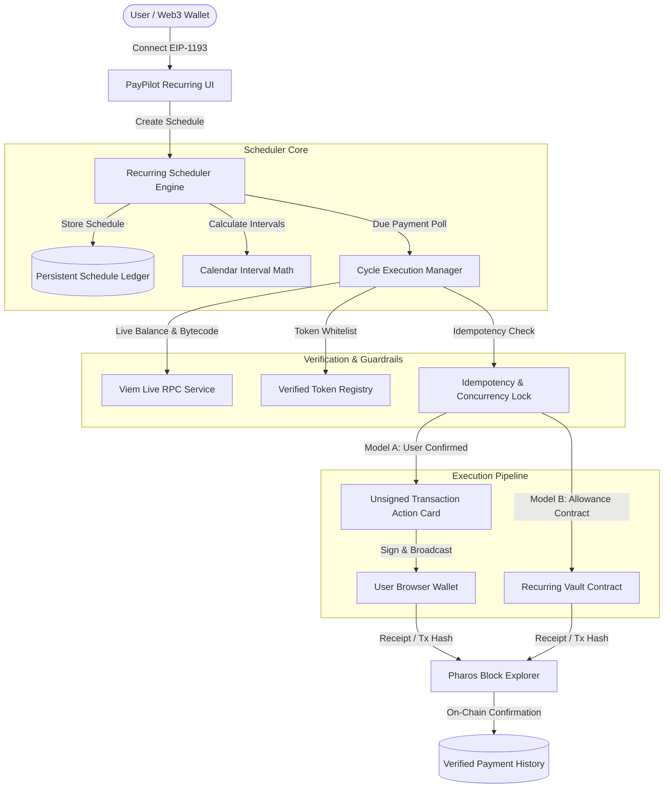

# PHAROS RECURRING PAYMENT AGENT — ARCHITECTURE SPECIFICATION

**Product:** Pharos Recurring Payment Agent  
**Date:** 2026-11-08  
**Repository:** https://github.com/JimmyOgb/pharos-recurring-payment-agent  

---

## 1. System Overview

Pharos Recurring Payment Agent is a non-custodial, deterministic financial scheduling agent engineered for repeating on-chain transfers (such as rent, subscription fees, and payroll distribution) across the Pharos ecosystem.

---

## 2. Core Architectural Components

### A. Frontend Layer (React 19 + TypeScript 5.7 + Tailwind CSS)
- **Dashboard:** Real-time telemetry, active schedule count, upcoming payment countdown, verified spending totals, and payment status breakdown (paid, pending, failed).
- **Create Schedule Wizard:** Recipient address input, verified token selection, transfer amount with integer decimal precision, weekly or monthly cadence selector, and start date.
- **Schedule Management:** Full lifecycle controls allowing users to inspect, pause, resume, cancel schedules, or revoke on-chain allowances.
- **Payment History Ledger:** Comprehensive chronological log with date, recipient, token, amount, verified transaction hash, block explorer link, and detailed failure diagnostics if applicable.
- **Upcoming Payments Radar:** Chronological queue of upcoming payments with live balance readiness checks.

### B. Recurring Scheduler Engine (`src/engine/scheduler.ts`)
- **Interval Engine:** Deterministic calculation for weekly (exact 7-day intervals) and monthly (calendar month intervals with month-end clipping, e.g. Jan 31 -> Feb 28).
- **Cycle Identifiers:** Every payment execution is bound to a deterministic `cycleIndex` and unique `idempotencyKey` formatted as `${scheduleId}-${cycleIndex}-${dueDate}`.
- **Lifecycle State Machine:**
  - Schedule states: `ACTIVE`, `PAUSED`, `CANCELLED`, `COMPLETED`.
  - Payment execution states: `SCHEDULED` → `DUE` → `PREPARING` → `PENDING` → `PAID` | `FAILED`.

### C. Live RPC & Token Registry Service (`src/services/liveRpc.ts`, `src/config/networks.ts`)
- Queries active Pharos Pacific Mainnet (`1672`), Pharos Atlantic Testnet (`688689`), and Base Mainnet (`8453`) RPC endpoints.
- Verifies contract bytecode presence (`eth_getCode`) for non-native tokens.
- Reads live native balances (`eth_getBalance`) and token balances (`balanceOf`).
- Enforces strict whitelist validation against authoritative Pharos canonical token registries.

### D. Durable Persistence Layer (`src/storage/db.ts`)
- Client and server-compatible persistent ledger.
- In-memory reactive state synchronized with `localStorage` on the client, and backed by REST API endpoints for server-side persistence and cron execution.
- Ensures schedules, payment records, and idempotency locks survive browser refreshes and service restarts.

---

## 3. Supported Networks & Authoritative Configuration

| Parameter | Pharos Pacific Mainnet | Pharos Atlantic Testnet | Base Mainnet (Cross-Chain) |
| :--- | :--- | :--- | :--- |
| **Chain ID** | `1672` (`0x688`) | `688689` (`0xa8231`) | `8453` (`0x2105`) |
| **RPC Endpoint** | `https://rpc.pharos.xyz` | `https://atlantic.dplabs-internal.com` | `https://mainnet.base.org` |
| **Native Token** | `PROS` (18 decimals) | `PROS` (18 decimals) | `ETH` (18 decimals) |
| **Explorer** | `https://www.pharosscan.xyz` | `https://atlantic.pharosscan.xyz/` | `https://basescan.org` |
| **Canonical USDC** | `0xc879c018db60520f4355c26ed1a6d572cdac1815` | `0xcfC8330f4BCAB529c625D12781b1C19466A9Fc8B` | `0x833589fcd6edb6e08f4c7c32d4f71b54bda02913` |
| **Native Gas Wrapper** | `0x52c48d4213107b20bc583832b0d951fb9ca8f0b0` (WPROS) | `0x838800b758277CC111B2d48Ab01e5E164f8E9471` (WPHRS) | `0x4200000000000000000000000000000000000006` (WETH) |
