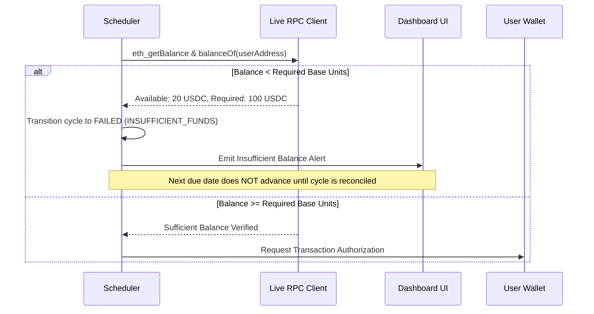

# PHAROS RECURRING PAYMENT AGENT — FAILURE & DUPLICATE PROTECTION

**Product:** Pharos Recurring Payment Agent  
**Date:** 2026-11-08  
**Repository:** https://github.com/JimmyOgb/pharos-recurring-payment-agent  

---

## 1. Idempotency Key & Execution Identity

To prevent double-billing under network latency, page refreshes, or concurrent scheduler workers, every recurring payment cycle is assigned a globally unique, deterministic **Idempotency Key**:

$$\text{IdempotencyKey} = \text{hash}(\text{scheduleId} + \text{cycleIndex} + \text{dueDateISO})$$

Example:
`rec_sched_9f8a-cycle_1-2026-11-15T00:00:00.000Z`

### Idempotency Invariants:
1. **Single Execution per Cycle:** A given `cycleIndex` for a schedule can transition to `PAID` exactly once.
2. **Locked State Transition:** When an execution starts, the cycle moves to `PREPARING` and locks. Any parallel call attempting to execute the same cycle is rejected immediately.
3. **Receipt Binding:** A payment record cannot be marked `PAID` without binding a verified transaction hash returned from the EVM node.

---

## 2. Insufficient Balance Handling

Payment failure due to insufficient funds is handled gracefully without breaking the schedule or wasting network fees:

1. **Pre-Flight Balance Check:**
   - Before compiling any transaction or requesting wallet signatures, the agent calls `balanceOf` (for ERC-20) and `eth_getBalance` (for native PROS/ETH and gas fees).
   - If available funds are below the required amount plus estimated gas, the cycle status transitions to `FAILED` with failure reason:
     `Insufficient USDC balance: Required 100 USDC, but wallet holds 20 USDC.`
2. **Zero Wasted Gas:**
   - Because the check is performed via read-only RPC calls, zero gas is spent broadcasting doomed transactions.
3. **Recovery & Resolution:**
   - The user can top up their wallet and click **"Retry Payment"** in the UI.
   - Alternatively, the user can pause or cancel the schedule.

---

## 3. Network Failure, Reversion & Double-Payment Defense

### Scenario A: Wallet Rejection
- If the user cancels the transaction prompt in MetaMask (`code: 4001`), the agent records:
  - Status: `FAILED`
  - Error: `Transaction was rejected by user in external wallet.`
  - Cycle remains available for user-initiated retry.

### Scenario B: RPC Timeout During Broadcast
- If an RPC timeout occurs while broadcasting:
  - The agent checks if a transaction hash was returned.
  - If a tx hash exists, the status is set to `PENDING` and the agent polls `eth_getTransactionReceipt` using exponential backoff (up to 60 seconds).
  - The cycle remains **LOCKED**. Under no circumstances will the agent submit a second transaction while the first is pending.
  - If the receipt confirms success (`status == 0x1`), the cycle transitions to `PAID`.
  - If the receipt indicates failure (`status == 0x0`), the cycle transitions to `FAILED (Transaction Reverted)`.

### Scenario C: Concurrent Workers / Multi-Tab Synchronization
- If the user opens the application across multiple browser tabs:
  - In-memory and local storage mutex locks prevent two tabs from triggering `eth_sendTransaction` for the same cycle simultaneously.
  - Server-side REST endpoints enforce atomic status updates with version checks (`optimistic locking`).
