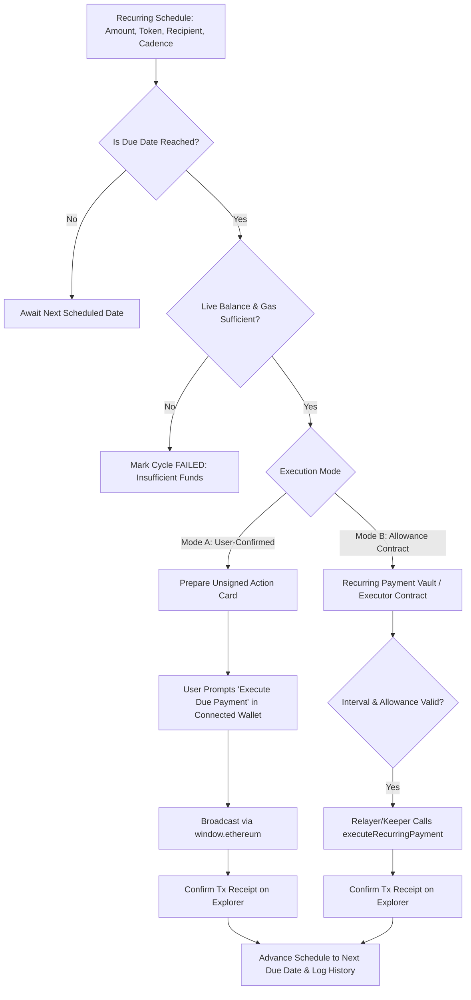

# PHAROS RECURRING PAYMENT AGENT — RECURRING EXECUTION MODEL

**Product:** Pharos Recurring Payment Agent  
**Date:** 2026-11-08  
**Repository:** https://github.com/JimmyOgb/pharos-recurring-payment-agent  

---

## 1. The Offline Browser Problem in EVM DApps

In standard EVM browser applications, payments require an active Web3 wallet session (e.g. MetaMask, Rabby). When a user closes their browser, powers off their device, or disconnects their wallet, **the browser cannot sign transactions**.

Any agent claiming that a pure client-side React app can magically execute unassisted payments while the user is offline is either:
1. Hallucinating or using fake timers (`setInterval` that only runs when the tab is open).
2. Storing user private keys on a server (which introduces catastrophic custodial risk).

Pharos PayPilot addresses this truthfully and transparently through a **Dual-Model Execution Architecture**.

---

## 2. Dual-Model Execution Architecture



### Model A: User-Confirmed Due-Payment Queue (Recommended / Non-Custodial Default)
- **How It Works:**
  - Schedules calculate exact future dates: `nextDueDate`.
  - When the current timestamp exceeds `nextDueDate`, the schedule moves to `DUE`.
  - The agent performs a live RPC pre-flight check to verify token balance and native gas readiness.
  - When the user opens the application with their connected wallet, PayPilot highlights due payments in the **Upcoming & Due Payments** queue with an active **"Execute Due Payment"** button.
  - Clicking this builds the exact EIP-155 transaction and prompts the user's wallet for approval.
  - Upon on-chain confirmation, the payment is recorded as `PAID`, the receipt is archived in the history ledger, and `nextDueDate` advances to the subsequent cycle.

### Model B: Allowance-Authorized Recurring Smart Contract
- **How It Works:**
  - The user deploys or authorizes a non-custodial recurring payment vault contract (`PharosRecurringVault.sol`).
  - The user approves an ERC-20 allowance (`approve(vaultAddress, totalAllowed)`).
  - The vault enforces on-chain state:
    ```solidity
    struct RecurringRule {
        address subscriber;
        address recipient;
        address token;
        uint256 amountPerCycle;
        uint256 intervalSeconds; // 604800 (weekly) or 2592000 (monthly)
        uint256 lastExecutionTime;
        bool active;
    }
    ```
  - Any keeper, cron worker, or relayer can call `executeRecurringPayment(ruleId)`.
  - The contract strictly enforces:
    1. `block.timestamp >= lastExecutionTime + intervalSeconds`
    2. Caller cannot change recipient or amount.
    3. Caller cannot exceed allowance.
  - The user can pause, cancel, or revoke allowance on-chain at any time.

---

## 3. Calendar Math & Cycle Interval Algorithms

### Weekly Schedules:
- Exact 7-day interval (604,800 seconds).
- `nextDueDate = previousDueDate + (7 * 24 * 60 * 60 * 1000)`.

### Monthly Schedules:
- Calendar-aware month arithmetic with month-end clipping:
  - If a schedule starts on the 31st:
    - January 31 → February 28 (or 29 in leap years) → March 31 → April 30.
- Implemented deterministically using standard UTC date calculations:
  ```ts
  function getNextMonthlyDate(currentDate: Date, originalDayOfMonth: number): Date {
    const year = currentDate.getUTCFullYear();
    const month = currentDate.getUTCMonth();
    const nextMonth = new Date(Date.UTC(year, month + 1, 1));
    const daysInNextMonth = new Date(Date.UTC(year, month + 2, 0)).getUTCDate();
    const targetDay = Math.min(originalDayOfMonth, daysInNextMonth);
    return new Date(Date.UTC(year, month + 1, targetDay, currentDate.getUTCHours(), currentDate.getUTCMinutes(), 0, 0));
  }
  ```

---

## 4. Schedule & Payment Lifecycle States

### Schedule States:
- `ACTIVE`: Schedule is running and will evaluate due payments.
- `PAUSED`: Schedule is temporarily suspended by user. No payments prepared or executed.
- `CANCELLED`: Schedule is permanently terminated.
- `COMPLETED`: Fixed-cycle schedule has fulfilled all requested occurrences.

### Payment Execution States:
- `SCHEDULED`: Future payment waiting for its due date.
- `DUE`: Due date has arrived; awaiting execution.
- `PREPARING`: Agent is querying on-chain balance and compiling transaction payload.
- `PENDING`: Transaction has been submitted to the network and is awaiting on-chain confirmation.
- `PAID`: Transaction confirmed on-chain with verified block receipt and explorer link.
- `FAILED`: Transaction reverted, rejected by user, or failed pre-flight balance check.
